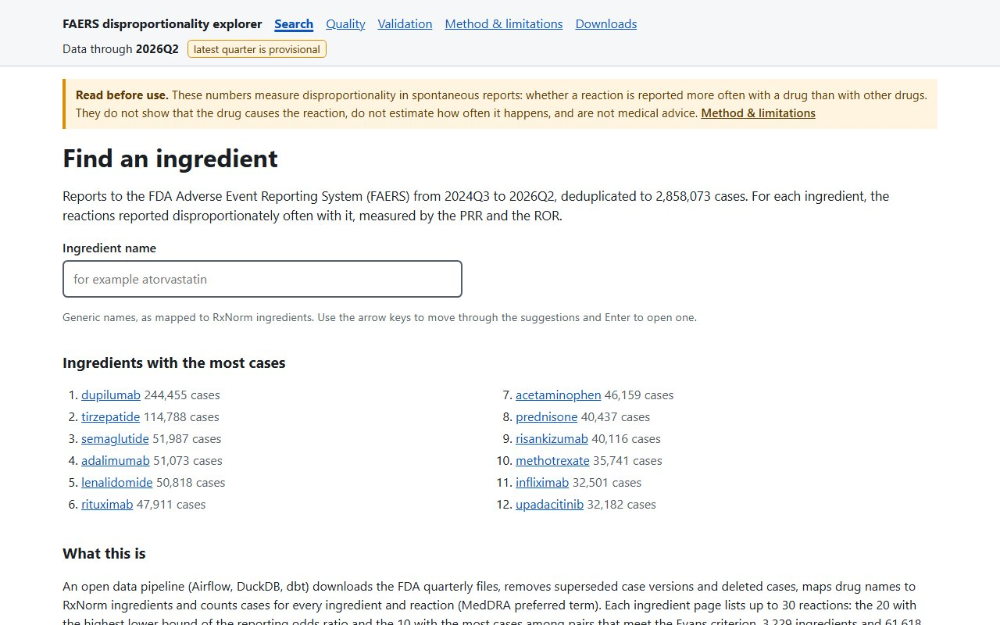
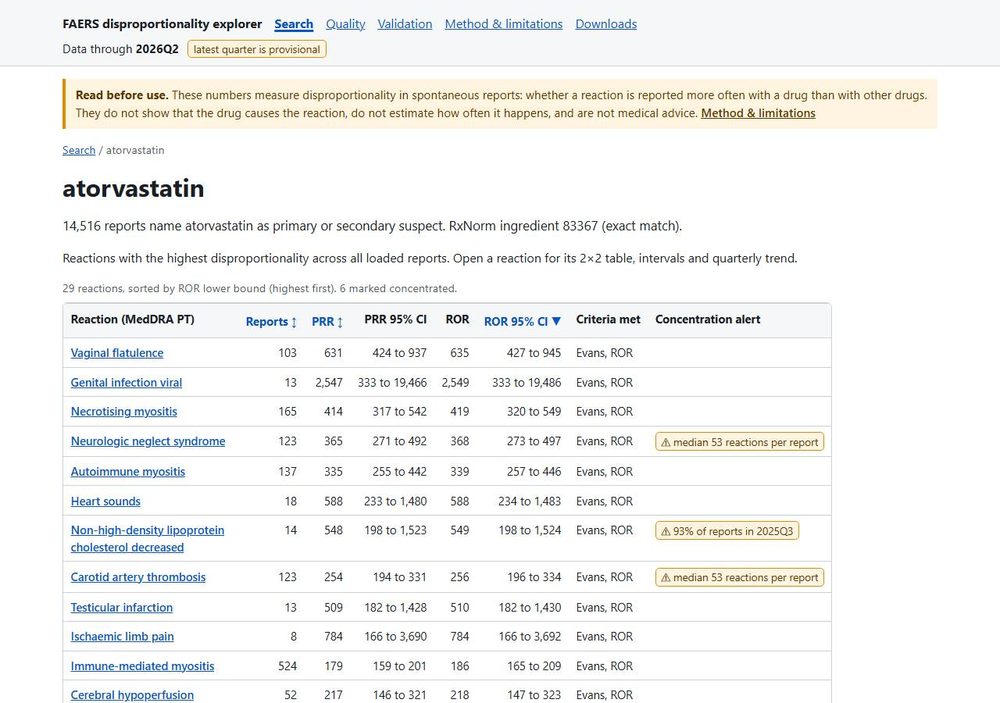
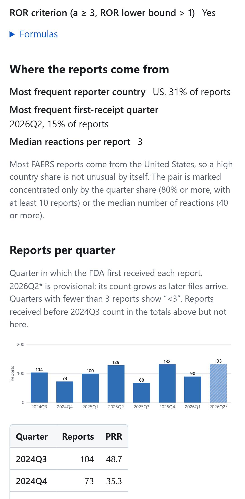
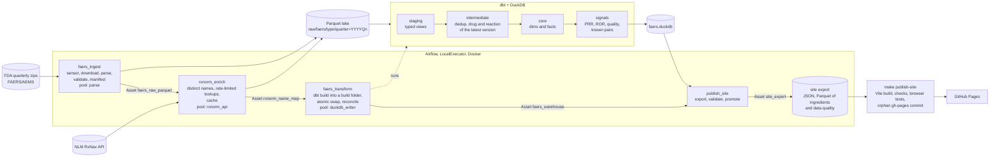

# FAERS Pipeline

[](https://github.com/YagoCalomino/faers-pipeline/actions/workflows/ci.yml)

Pharmacovigilance looks for adverse drug reactions after a drug reaches the market. The FDA
publishes every spontaneous report it receives (FAERS, now the FDA Adverse Event Monitoring
System, AEMS) as quarterly files. This project turns those files into a tested, reproducible
data pipeline: Airflow ingests the quarters, RxNorm normalizes drug names, dbt and DuckDB
deduplicate cases and compute disproportionality (PRR, ROR), and a static site publishes the
results with their data-quality metrics.

**Explorer:** <https://yagocalomino.github.io/faers-pipeline/> (static site, no backend).

| Search | Ingredient page | Pair detail on a phone |
|---|---|---|
|  |  |  |

## Architecture



## What this shows, and what it does not

- Airflow 3: idempotent DAGs chained by Assets, backfill, dynamic task mapping, pools, retries,
  and a reschedule sensor that waits for the next quarter's file once `end_quarter` is raised in
  `config/faers.yaml` ([runbook](docs/runbook.md)).
- dbt and DuckDB over a Parquet lake: deduplication by case version, a dimensional model, signal
  marts, data tests on every layer, results checked by hand recalculation and reference pairs.
- Schema contract: each FAERS file type has its required columns in
  `config/faers_schema.yaml`; `quality.check_contract` fails the ingest when one is missing,
  and an extra column is only recorded in the quarter's manifest (`extra_columns`).
- **Not shown:** causality or incidence (reports have no exposure denominator;
  disproportionality only points to pairs for review), distributed processing, clinical review.
  Not medical advice.
- An adapter for Anvisa's VigiMed open data is a natural extension; it would need its own
  drug-name normalization and its own handling of MedDRA terms.

## Numbers

<!-- readme-numbers:start -->
- **2,858,073 cases** after deduplication of 3,253,489 case versions in the quarterly files 2024Q3 to 2026Q2 (8 files).
- **99.05%** of the PS/SS drug lines mapped to an RxNorm ingredient.
- **61,618 ingredient-reaction pairs** on the site, for 3,229 ingredients.
- **12 of 12** reference pairs as expected (9 positive, 3 negative controls).
- **3.4 min** for the full dbt build (models and tests).

All numbers: [docs/numbers.md](docs/numbers.md). Generated by `scripts/readme_numbers.py`. Build measured 2026-10-27. Run times collected 2026-10-27.
<!-- readme-numbers:end -->

## Decisions and trade-offs

| Decision | Alternative not taken | Why |
|---|---|---|
| Airflow in Docker, LocalExecutor | Managed Airflow, CeleryExecutor | No cost; Celery adds a broker without benefit at this scale |
| DuckDB as engine, Parquet as durable storage | Postgres, Spark | A few GB of data; no server; portable files |
| dbt (`dbt-duckdb`) for every transformation, in its own virtualenv | SQL in Python tasks; dbt in the Airflow environment | Tests, lineage and docs; no conflicts with Airflow's constraints |
| Raw layer as text, typing in dbt staging | Typing while parsing | Raw stays faithful to the files; types are versioned SQL |
| Deduplication by `caseid`, highest `caseversion`, minus FDA deletion lists | Fuzzy matching on demographics | Simple and auditable; uses the identifiers and deletion lists FDA publishes |
| Case quarter = quarter of first receipt by FDA ([ADR 0001](docs/adr/0001-time-anchor.md)) | Event date, file quarter | Always filled; stable across versions |
| dbt Core with the classic parser ([ADR 0002](docs/adr/0002-dbt-version.md)) | The new parser | DuckDB support of the new parser was still in beta |
| RxNorm exact and normalized matches only | Approximate matches above a score | On a labelled sample, scores did not separate right from wrong matches ([limitations](docs/limitations.md)) |
| Full, atomic warehouse build (build folder, swapped in only if every model and test passes) | Incremental models merged in place | The full build takes about 3.4 min; FDA republishes quarters and deduplication by `caseversion` touches old cases; a swap is simpler to audit than a merge, and a failed test never leaves a half-built warehouse |
| A hand-written static site (Vite, plain JavaScript) reading one JSON file per ingredient ([ADR 0003](docs/adr/0003-site-tooling.md)) | DuckDB-WASM, Observable Framework, Evidence | Measured on a simulated phone: seconds instead of tens of seconds to the first data |
| Site published from a local orphan `gh-pages` branch, pushed by hand | Deploy from CI | The site needs the full warehouse (about 1.5 GB, built locally from the lake) and CI only has the fixture subset, so publishing is a manual step after the export is validated |

## Limitations

Under-reporting and reporting bias; the latest quarter is provisional; unmatched drug names stay
as "fallback" ingredients; MedDRA terms are used without the hierarchy; reporting clusters are
flagged, not corrected. Full text: [docs/limitations.md](docs/limitations.md).

## Reproduce

Needs Docker with about 4 GiB of free memory for the build, GNU Make 4.2+, git, and Node.js
22.12+ for the site; no Python on the host (lint, tests and dbt run in the Airflow image).
`make env && make up` starts Airflow at <http://localhost:8080>; unpause the four DAGs and each
quarter of `config/faers.yaml` runs through the chain ([runbook](docs/runbook.md)).

```bash
make dbt-rebuild  # full atomic warehouse build, outside Airflow
make publish-site # validated export, site build and checks, local gh-pages commit (no push)
make lint         # ruff, format check and docs consistency
make test         # pytest: unit tests and DAG integrity (DagBag)
make dbt-ci       # dbt build on a test lake made from the real fixture subset
make site-ci      # site on the fixture export: build, checks, unit and browser tests (axe)
```

Fixtures are small real subsets of FAERS and RxNorm; CI runs the same checks. Layout:
[docs/README.md](docs/README.md); conventions: [CONTRIBUTING.md](CONTRIBUTING.md).

## Data sources and terms

- [FDA FAERS/AEMS quarterly data files](https://www.fda.gov/drugs/fda-adverse-event-monitoring-system-aems/fda-adverse-event-monitoring-system-aems-latest-quarterly-data-files):
  public domain under FDA's website policies; FDA does not endorse this project.
- RxNorm through the NLM RxNav API ([RxNav terms](https://lhncbc.nlm.nih.gov/RxNav/TermsofService.html),
  [RxNorm terms](https://www.nlm.nih.gov/research/umls/rxnorm/docs/termsofservice.html)):
  ingredient names and RxCUIs are public domain. The name cache is not updated with later
  releases, so the mapping may not reflect the most current or accurate data from NLM.

> This product uses publicly available data from the U.S. National Library of Medicine (NLM),
> National Institutes of Health, Department of Health and Human Services; NLM is not
> responsible for the product and does not endorse or recommend this or any other product.

Reaction terms are MedDRA® Preferred Terms as reported in FDA FAERS. MedDRA® is a registered
trademark of the International Council for Harmonisation of Technical Requirements for
Pharmaceuticals for Human Use (ICH). This project does not distribute the MedDRA dictionary and
does not offer a downloadable dataset of MedDRA terms. Reaction terms (Preferred Terms) are
shown on the site pages as they appear in FAERS.

## Author's notes
- **How it was built.** I used an AI coding assistant to write much of the code under my instructions. Scope, design decisions, calibration and validation are mine, and are documented in `docs/`.
- **Scope.** A reproducible pipeline over public pharmacovigilance data, to practise orchestration (Airflow), transformation (dbt) and analytics on DuckDB, in a domain close to my work in healthcare software.
- **Decisions.** I made the final call at each decision point: approximate RxNorm matching stays off after the calibration sample, concentrated report patterns are flagged instead of filtered out, and the site is published as a manual, validated step.
- **Checks.** I run the builds and the publishing steps myself and read every change report and test result before pushing. I checked the label references of the 12 known pairs against the FDA label text.

## License

Code: [MIT](LICENSE). The license covers the code of this repository, not the FDA or NLM data.

## Português (Brasil)

Pipeline de farmacovigilância sobre os relatos trimestrais do FDA (FAERS/AEMS): Airflow, RxNorm,
dbt e DuckDB calculam desproporcionalidade (PRR, ROR) por par ingrediente–reação, publicada num
site estático. Não prova causalidade: aponta pares para investigação. Detalhes no texto em
inglês acima.
