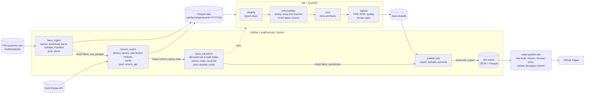

# FAERS Pipeline

[](https://github.com/YagoCalomino/faers-pipeline/actions/workflows/ci.yml)

Pharmacovigilance looks for adverse drug reactions after a drug reaches the market. The FDA
publishes every spontaneous report it receives (FAERS, now the FDA Adverse Event Monitoring
System, AEMS) as quarterly files. This project turns those files into a tested, reproducible
data pipeline: Airflow ingests the quarters, RxNorm normalizes drug names, dbt and DuckDB
deduplicate cases and compute disproportionality (PRR, ROR), and a static site publishes the
results with their data-quality metrics.

**Explorer:** <https://yagocalomino.github.io/faers-pipeline/> (static site, no backend).


## Architecture



- Ingestion writes only Parquet; dbt is the only writer of the DuckDB file (pool
  `duckdb_writer`, one slot). The Parquet lake is the source of truth; the warehouse can be
  rebuilt at any time and a failed build never replaces the previous one.
- DAGs are chained by data (Airflow Assets): a quarter ingested triggers the RxNorm lookups,
  the warehouse build and the site export, each only after the previous step and its quality
  gate succeeded.

## What this proves, and what it does not

It shows:

- Orchestration with Airflow 3: idempotent DAGs, backfill, dynamic task mapping, a reschedule
  sensor for the next quarter, pools, retries, failure callbacks and data-driven scheduling.
- Analytics engineering with dbt and DuckDB over a partitioned Parquet lake: staging,
  deduplication by case version, a dimensional model, signal marts and data tests on every
  layer.
- Two ingestion patterns: quarterly files (checksums, contracts, atomic writes) and a
  rate-limited API with a persistent cache.
- Real data quality work: superseded versions and deleted cases, free-text drug names mapped
  with a precision-first policy, metrics published next to the results.
- Statistical results checked three ways: hand recalculation, reference pairs and a comparison
  of the published pages with the warehouse.

It does not show:

- **Causality or incidence.** Spontaneous reports have no exposure denominator.
  Disproportionality is a screening statistic: a pair that meets a criterion is a hypothesis for
  review, not evidence that the drug causes the reaction.
- Managed cloud or distributed processing (Spark): the volume fits one machine, so the choice
  was DuckDB.
- Clinical review of individual pairs, or deduplication across different reporters of the same
  event.

## Numbers

All values below come from the warehouse marts and from recorded measurements
(`make readme-numbers`); none is typed by hand.

<!-- readme-numbers:start -->
| | |
|---|---|
| FAERS quarterly files loaded | 2024Q3 to 2026Q2 (8 files) |
| Signal window (FDA first-receipt quarter) | 2024Q3 to 2026Q2 (8 quarters) |
| Case versions in the files (DEMO rows) | 3,253,489 |
| Cases after deduplication | 2,858,073 |
| Removed: superseded versions / deleted cases | 382,504 / 12,912 (12.2% of the rows) |
| PS/SS drug lines mapped to an RxNorm ingredient | 99.05% of 7,182,171 (exact match 98.98%) |
| RxNorm release of the name cache | 05-Oct-2026 |
| Ingredient-reaction pairs, all quarters (a >= 3) | 674,947 (672,972 computable; 414,726 meet the Evans criterion, 430,661 the ROR criterion) |
| Rows of `mart_signals` (8 quarters and all) | 1,876,964 |
| Pairs on the site | 61,618 for 3,229 ingredients |
| Reference pairs as expected | 12 of 12 (9 positive, 3 negative controls) |
| Full dbt build (models and tests) | 3.4 min, 30 model success, 3 seed success, 152 test pass, 1 unit_test pass |
| Memory peak of the build | 3.05 GiB (container), 2.99 GiB (dbt process); DuckDB memory_limit 2.5GB |
| Warehouse file | 1,500.0 MB |
| Site export | 3,239 files, 59.3 MB |
| Built site | 3,244 files, 59.8 MB (largest file 6.4 MB) |
| Airflow: one quarter of `faers_ingest` (median of 8 runs) | 2.2 min |
| Airflow: first full `rxnorm_enrich` (API lookups at 5 requests/s) / later runs (cache) | 51.0 min / 0.2 min |
| Airflow: `faers_transform` / `publish_site` (median) | 3.5 min / 2.8 min |
| Disk: zips / Parquet lake / warehouse | 538.7 MB / 350.1 MB / 1,500.0 MB |

Generated by `scripts/readme_numbers.py`. Build measured 2026-10-27. Run times collected 2026-10-27.
<!-- readme-numbers:end -->

## Decisions and trade-offs

| Decision | Alternative not taken | Why |
|---|---|---|
| Airflow in Docker, LocalExecutor | Managed Airflow, CeleryExecutor | No cost; Celery adds a broker without benefit at this scale |
| DuckDB as engine, Parquet as durable storage | Postgres, Spark | A few GB of data; no server; portable files |
| dbt (`dbt-duckdb`) for every transformation, in its own virtualenv | SQL in Python tasks; dbt in the Airflow environment | Tests, lineage and docs; no dependency conflicts with Airflow's constraints |
| Raw layer as text, typing in dbt staging | Typing while parsing | Raw stays faithful to the files; types are versioned SQL |
| Deduplication by `caseid`, highest `caseversion`, minus FDA deletion lists | Fuzzy matching on demographics | Simple and auditable; uses the case identifiers and deletion lists FDA publishes |
| Case quarter = quarter of first receipt by FDA ([ADR 0001](docs/adr/0001-time-anchor.md)) | Event date, file quarter | Always filled; stable across versions |
| dbt Core with the classic parser ([ADR 0002](docs/adr/0002-dbt-version.md)) | The new parser | DuckDB support of the new parser was still in beta |
| RxNorm exact and normalized matches only; approximate search off | Approximate matches above a score | Calibrated on a labelled sample: scores did not separate right from wrong matches ([limitations](docs/limitations.md)) |
| Atomic warehouse build (build folder, swap only if every model and test passes) | Build in place | A failed test never leaves a half-built warehouse |
| Static site of the project's own (Vite, plain JavaScript) reading one JSON file per ingredient ([ADR 0003](docs/adr/0003-site-tooling.md)) | DuckDB-WASM, Observable Framework, Evidence | Measured on a simulated phone: seconds instead of tens of seconds to the first data |
| Site published from a local orphan `gh-pages` branch, pushed by hand | Deploy from CI | Nothing leaves this environment automatically |

## Limitations (summary)

- Spontaneous reporting: under-reporting, reporting bias (publicity, litigation, new drugs), no
  denominator. The latest quarter is provisional: its cases keep arriving in later files.
- Drug names: unmatched names stay as their own "fallback" ingredient, so a drug can be split
  between its RxNorm ingredient and a fallback text; combination products count once per
  ingredient.
- MedDRA preferred terms are used one by one, without the hierarchy.
- Reporting clusters (long reports listing dozens of reactions, reports concentrated in one
  quarter) are flagged on the site, not corrected.
- Operational: see the last section of [docs/limitations.md](docs/limitations.md).

Full text: [docs/limitations.md](docs/limitations.md).

## Reproduce

Prerequisites: Docker (Docker Desktop on Windows or macOS) with enough memory for the build
peak in the table above plus Airflow, GNU Make 4.2 or newer, and git. The site build also needs
Node.js 22.12 or newer on the host. Python is not needed on the host: lint, tests and dbt run
inside the Airflow image.

```bash
make env          # creates .env from .env.example (first time only)
make up           # builds the image and starts Airflow at http://localhost:8080
```

In the Airflow UI (user and password from `.env`), unpause `faers_ingest`, `rxnorm_enrich`,
`faers_transform` and `publish_site`. `faers_ingest` then creates one run per quarter of the
window in `config/faers.yaml`, and each successful ingestion triggers the rest of the chain.
Run times and disk space measured on this project are in the table above. Details, backfill and
recovery steps: [docs/runbook.md](docs/runbook.md).

```bash
make dbt-rebuild  # full atomic warehouse build, outside Airflow
make reconcile    # lake -> warehouse counts recomputed independently
make publish-site # validated export, site build and checks, local gh-pages commit (no push)
make down
```

## Tests

```bash
make lint         # ruff check and format check
make test         # pytest: unit tests and DAG integrity (DagBag)
make dbt-ci       # dbt build on a test lake made from the real fixture subset
make site-ci      # site on the fixture export: build, checks, unit and browser tests (axe)
```

Fixtures are small real subsets of FAERS and RxNorm data (`tests/fixtures/`). The same checks
run in GitHub Actions on every pull request and push to `main`
([.github/workflows/ci.yml](.github/workflows/ci.yml)).

## Repository

```
config/      pipeline settings (sources, schema contract, RxNorm, signals, site)
dags/        Airflow DAGs: faers_ingest, rxnorm_enrich, faers_transform, publish_site
src/         Python package faers_pipeline (download, parse, quality, RxNorm client,
             warehouse build, export, callbacks)
dbt/         dbt project faers_dbt (staging, intermediate, core, signals; seeds; tests)
site/        static explorer (Vite) with its build checks and browser tests
scripts/     command-line entry points used by make (fixtures, export, checks, numbers)
infra/       Dockerfile, docker-compose and Airflow pools
tests/       pytest suite and real fixtures
docs/        runbook, data dictionary, limitations, ADRs, screenshots
```

More: [docs/README.md](docs/README.md).

## Data sources and terms

- **FDA FAERS/AEMS quarterly data files**, U.S. Food and Drug Administration
  ([quarterly data files](https://www.fda.gov/drugs/fda-adverse-event-monitoring-system-aems/fda-adverse-event-monitoring-system-aems-latest-quarterly-data-files)).
  FDA's website policies state that its text and graphics are in the public domain and may be
  republished; FDA does not endorse this project.
- **RxNorm, through the NLM RxNav API**
  ([RxNav terms of service](https://lhncbc.nlm.nih.gov/RxNav/TermsofService.html),
  [RxNorm terms of service](https://www.nlm.nih.gov/research/umls/rxnorm/docs/termsofservice.html)).
  The site and the downloads publish RxNorm ingredient names and RxCUIs, which the RxNorm terms
  describe as public domain. The name cache is not updated with later RxNorm releases, so the
  mapping may not reflect the most current or accurate data available from NLM.

Required statement of the RxNav terms of service:

> This product uses publicly available data from the U.S. National Library of Medicine (NLM),
> National Institutes of Health, Department of Health and Human Services; NLM is not
> responsible for the product and does not endorse or recommend this or any other product.

Reaction terms are MedDRA® Preferred Terms as reported in FDA FAERS. MedDRA® is a registered
trademark of ICH. This project does not distribute MedDRA.

## License

Code: [MIT](LICENSE). The license covers the code of this repository, not the FDA or NLM data.

| Ingredient page | Pair detail on a phone |
|---|---|
|  |  |

## Português (Brasil)

Pipeline de farmacovigilância sobre os relatos espontâneos de eventos adversos que o FDA
publica a cada trimestre (FAERS, hoje AEMS). O Airflow ingere os arquivos trimestrais em
Parquet, consulta o RxNorm (NLM) para normalizar os nomes de medicamentos e dispara o dbt, que
deduplica os casos em DuckDB, monta um modelo dimensional e calcula desproporcionalidade (PRR e
ROR) por par ingrediente–reação. Um site estático publica os resultados, as métricas de
qualidade e a comparação com pares de referência.

Desproporcionalidade não prova causalidade nem estima incidência: é um filtro que aponta pares
para investigação. Os números acima saem de scripts que consultam o warehouse.

Para rodar: Docker, GNU Make e git (Node.js 22.12+ só para gerar o site).

```bash
make env && make up   # Airflow em http://localhost:8080
```

Na interface, despause `faers_ingest`, `rxnorm_enrich`, `faers_transform` e `publish_site`; a
cadeia roda sozinha, trimestre a trimestre. Depois, `make publish-site` gera o site e a branch
`gh-pages` local. Testes: `make lint`, `make test`, `make dbt-ci`, `make site-ci`. Passo a passo
e recuperação de falhas em [docs/runbook.md](docs/runbook.md); limitações em
[docs/limitations.md](docs/limitations.md).
